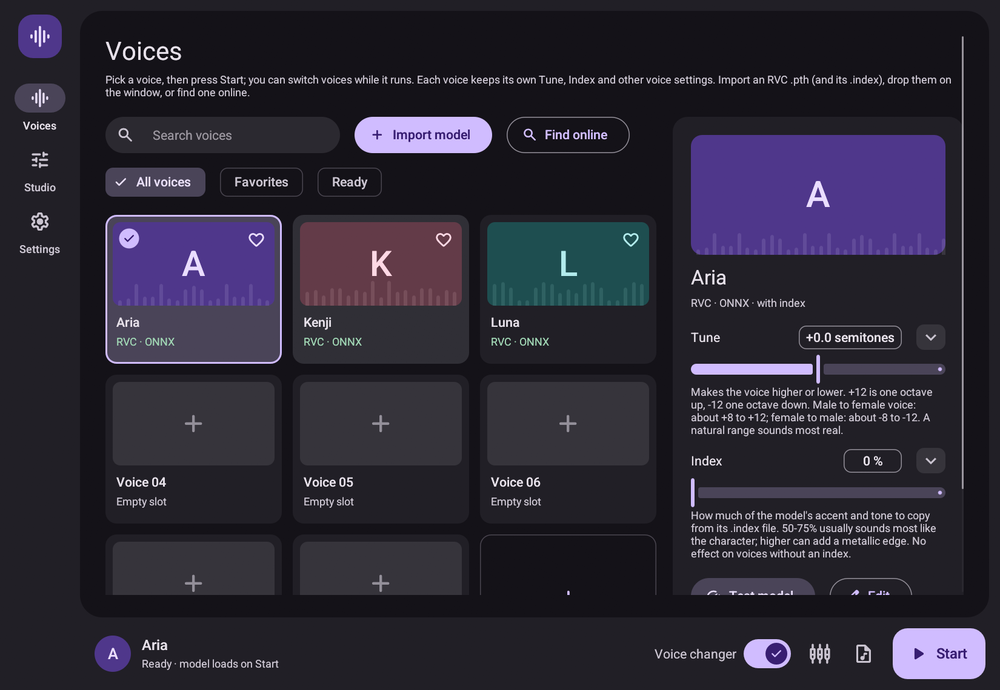

<div align="center">

# Voice Changer

**A native, real-time RVC voice changer written in Rust.**
No Python, no browser, no local server: one desktop app.

[](https://github.com/Araryarch67/voice-changer/actions/workflows/release.yml)
[](https://github.com/Araryarch67/voice-changer/releases)
[](LICENSE)




</div>

## About

Voice Changer converts your microphone into another voice as you speak, using [RVC](https://github.com/RVC-Project/Retrieval-based-Voice-Conversion-WebUI) v2 models. It is a Rust port of [w-okada/voice-changer](https://github.com/w-okada/voice-changer): the same audio pipeline, rebuilt as a single native application with [egui](https://github.com/emilk/egui), [CPAL](https://github.com/RustAudio/cpal) and [ONNX Runtime](https://onnxruntime.ai/).

> [!NOTE]
> This is a work in progress and does not yet match every feature of the original. See [Status](#status).

## Features

- **Real-time conversion** with RVC v2 models, pitch shifting (Tune) and speaker selection.
- **Index retrieval** that reads RVC's FAISS `IndexIVFFlat` `.index` files directly, without the FAISS library.
- **Noise handling**: RNNoise suppression in two strengths (Sup1, Sup2), a noise gate and echo cancellation.
- **Pitch detectors**: RMVPE, CREPE, Harvest, DIO and YIN.
- **GPU or CPU**: CUDA through ONNX Runtime where available, CPU everywhere else.
- **One-step import**: pick an RVC `.pth` or `.zip` and the app converts it to ONNX, finds its index and adds the voice, no Python needed. Each voice can have its own picture.
- **Recording** of the microphone and the converted voice to WAV, and offline WAV file conversion.
- **Material 3 interface** with a plain-language hint under every option.

## Download

Prebuilt archives for each tagged version are on the [Releases](https://github.com/Araryarch67/voice-changer/releases) page.

| Platform | File | GPU |
|---|---|---|
| Windows x64 | `voice-changer-windows-x64-setup.exe` (or `.zip`) | DirectML: any DirectX 12 GPU, nothing to install |
| Windows x64, NVIDIA | `voice-changer-windows-x64-cuda-setup.exe` (or `.zip`) | CUDA: fastest on NVIDIA; needs CUDA 12 and cuDNN 9 |
| Linux x64 | `voice-changer-linux-x64.deb` / `.rpm` (or `.zip`) | CPU; CUDA with a GPU build of ONNX Runtime |

Each download bundles ONNX Runtime 1.22, and the CPU always works. Voice models are not included.

## Quick start

1. Install it (or extract the ZIP and run `voice-changer-native`).
2. Add a voice: press **Import model** (or an empty **+** card), pick the RVC `.pth`, and pick its `.index` if it has one; the index beside the `.pth` is filled in for you. Dropping the files on the window does the same. This needs `contentvec.onnx` and `rmvpe.onnx` in `models/shared/`.
3. Put on headphones, pick the voice, and press **Start**.

To send the converted voice to another app such as Discord or OBS: on Linux, turn on **Settings → Virtual microphone** and pick "Voice Changer Mic" in that app; on Windows, choose a virtual audio cable as the output. Turn on **Monitor** to hear yourself on headphones at the same time.

### Preparing a voice

Importing does this for you. By hand, a voice is a small JSON manifest that points at three ONNX files: the RVC voice, a ContentVec embedder and an RMVPE pitch model. Convert a checkpoint with:

```sh
voice-changer-native --export-rvc voice.pth models/myvoice/voice-realtime.onnx --realtime
```

The manifest format, the expected model inputs and outputs, and how to attach a `.index` file are documented in [native-rust/README.md](native-rust/README.md#model-contract).

## Build from source

You need a recent stable Rust toolchain. On Linux, also install the ALSA development package.

```sh
git clone https://github.com/Araryarch67/voice-changer
cd voice-changer/native-rust
cargo run --release
```

ONNX Runtime is loaded at run time. Point `ORT_DYLIB_PATH` at an ONNX Runtime shared library, or place it in `native-rust/runtime/`.

### GPU

GPU inference uses ONNX Runtime's CUDA provider, so it needs a GPU build of ONNX Runtime with matching CUDA and cuDNN libraries. On Arch Linux:

```sh
sudo pacman -S onnxruntime-cuda cudnn
ORT_DYLIB_PATH=/usr/lib/libonnxruntime.so cargo run --release
```

Then choose **GPU (CUDA)** under **Settings → Processing**. As a rough guide from one machine, a 320 ms block took about 25 ms on an RTX 5070 Ti and about 200 ms on eight CPU threads of a Core Ultra 9 275HX.

## Status

| Area | State |
|---|---|
| RVC v1 and v2, with and without f0 (32, 40, 48 kHz) | Supported |
| Tune, index ratio, protect, gain, chunk, extra, crossfade | Supported |
| Noise suppression and noise gate | Supported |
| Pitch detection | RMVPE, CREPE (full, tiny), Harvest, DIO and built-in YIN |
| CUDA GPU | Supported with a GPU build of ONNX Runtime |
| Recording and WAV file conversion | Supported |
| Echo cancellation | Supported (WebRTC AEC3) |
| FCPE pitch detector | Not yet |
| Checkpoint export for RVC v1 and v2, with and without f0 | Supported |
| Other engines (MMVC, so-vits-svc, DDSP-SVC, Beatrice), training | Not planned for now |

Linux is the platform this is developed and tested on. Windows builds are produced by CI and are less exercised; Android and iOS entry points exist but are experimental.

## Repository layout

| Path | Contents |
|---|---|
| [`native-rust/`](native-rust) | The application and its documentation |
| [`.github/workflows/release.yml`](.github/workflows/release.yml) | Release builds for Linux and Windows |
| [`AGENTS.md`](AGENTS.md) | Notes for contributors and coding agents |

## Contributing

Issues and pull requests are welcome. Before opening a pull request, run these from `native-rust/`:

```sh
cargo fmt --check
cargo clippy --all-targets -- -D warnings
cargo test
```

## Acknowledgements

- [w-okada/voice-changer](https://github.com/w-okada/voice-changer), the project this is ported from.
- [RVC-Project](https://github.com/RVC-Project/Retrieval-based-Voice-Conversion-WebUI) for the voice conversion models.
- [nnnoiseless](https://github.com/jneem/nnnoiseless) (RNNoise), [egui](https://github.com/emilk/egui), [CPAL](https://github.com/RustAudio/cpal) and [ort](https://github.com/pykeio/ort).
- [Roboto](https://fonts.google.com/specimen/Roboto) and [Material Symbols](https://fonts.google.com/icons), bundled under their own licenses in `native-rust/assets/fonts`.

## License

[MIT](LICENSE). Only use voice models you have the right to use, and do not use this to impersonate someone without their consent.
