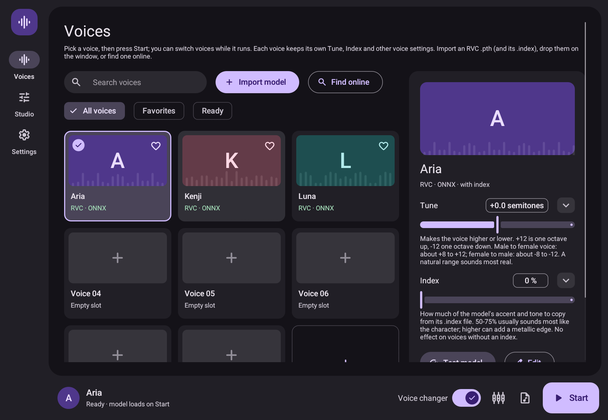

# Voice Changer Native

A Rust + egui prototype based on the audio flow of the original Python application (kept locally in `../reference/`, see `../AGENTS.md`). The interface is a Material 3 dark theme (`src/m3.rs`): a navigation rail, a voice card gallery and a persistent audio control bar, with bundled Roboto and Material Symbols subsets (`assets/fonts`). Below 650 logical pixels the rail becomes a bottom navigation bar.



[Narrow layout preview](docs/preview-mobile.png)

The application does not launch Python, a browser, or a server. It uses eframe/egui and WGPU for the interface, CPAL for audio, crossbeam-queue for bounded audio queues, and ort for ONNX inference. ONNX Runtime and operating-system audio/graphics libraries are native dependencies; “Rust application” does not mean every dependency is implemented in Rust.

## Current scope

- Model cards, search, favorites, editable/importable manifest paths, saved settings.
- Microphone/output selection, input downmix, gain, output limiter, bypass, meters and processing/queue statistics.
- Dedicated inference worker; audio callbacks do not run inference or acquire mutexes.
- Float32 RVC ONNX inference, waveform-in ContentVec/HuBERT and RMVPE, semitone adjustment and speaker ID.
- Context buffering, windowed-sinc resampling and SOLA/crossfade between blocks.
- Optional nearest-neighbor retrieval with unvoiced protection, reading RVC's FAISS `IndexIVFFlat` `.index` files natively (no FAISS library) or a portable float32 feature bank.
- RNNoise noise suppression (`Sup1` cleans the microphone; `Sup2` also mutes non-speech and cleans the output), a block noise gate, and echo cancellation (WebRTC AEC3) for use with speakers.
- Pitch detection with RMVPE, CREPE (`crepe_full.onnx` / `crepe_tiny.onnx` beside the RMVPE model), WORLD's Harvest and DIO, or built-in YIN. CREPE, Harvest and DIO reproduce the reference's output on the same audio.
- Built-in virtual microphone on Linux: **Settings → Virtual microphone** creates a "Voice Changer Mic" input (a null sink plus a remapped monitor source, through `pactl` on PipeWire or PulseAudio) that Discord, OBS or games can select. It stays while you are logged in, even with the app closed, so those apps never lose it and fall back to the real microphone; it carries silence while the voice changer is off. While the app is open, a guard checks every second that the microphone still reads only the app's output and moves it back (or mutes it) otherwise. Switching the option off removes it.
- Optional CUDA execution provider, selected in Settings when the loaded ONNX Runtime is a GPU build with matching CUDA and cuDNN libraries (on Arch: `onnxruntime-cuda` and `cudnn`, with `ORT_DYLIB_PATH=/usr/lib/libonnxruntime.so`); a CPU runtime only offers CPU.
- Offline WAV conversion and CLI device enumeration.
- Android NativeActivity entry point and runtime microphone permission request; iOS entry point, permission/audio-session integration and XcodeGen project.

This is **not yet feature parity** with the reference. non-standard RVC checkpoint architectures (and the WebUI `params` checkpoint format), FAISS index types other than L2 IVF-Flat, FP16 model inputs, the FCPE pitch detector, training, soundboard and the other VC engines are not implemented. Model import currently accepts a JSON path, rather than downloading models; checkpoints are converted with `--export-rvc` (below). The portable bank does exhaustive nearest-neighbor search and is intended for small banks; IVF indexes search the stored `nprobe` closest lists, like the reference.

## Run on desktop

The [GitHub releases](https://github.com/Araryarch67/voice-changer/releases) provide Windows `-setup.exe` installers and Linux x64 `.deb` / `.rpm` packages. Portable ZIP archives are also available. Each platform publishes its files as soon as its build finishes.

On Windows, run the setup executable; it installs for the current user and adds a Start Menu shortcut and an uninstaller. On Linux, install the DEB with `sudo apt install ./voice-changer-linux-x64.deb` or the RPM with `sudo dnf install ./voice-changer-linux-x64.rpm`, then launch **Voice Changer** from the application menu. Installed Linux builds use `${XDG_DATA_HOME:-$HOME/.local/share}/voice-changer/models` for user models. The packages include the CPU ONNX Runtime; voice models are obtained separately.

The standard Windows download (`voice-changer-windows-x64`) includes the DirectML build of ONNX Runtime, so any DirectX 12 GPU (NVIDIA, AMD or Intel) can be used with nothing else to install: choose **GPU (DirectML)** in Settings. On laptops with two GPUs the discrete one is used, and Settings shows its name. DirectML is usually somewhat slower than CUDA on NVIDIA.

For the fastest NVIDIA path on Windows, use `voice-changer-windows-x64-cuda-setup.exe` (or its ZIP) instead. It bundles the CUDA build of ONNX Runtime 1.22, which needs a recent NVIDIA driver, [CUDA 12.x](https://developer.nvidia.com/cuda-downloads) and [cuDNN 9.x for CUDA 12](https://developer.nvidia.com/cudnn-downloads) installed separately. The app adds cuDNN's install folder (`C:\Program Files\NVIDIA\CUDNN\v9.*\bin\12.*`) and `%CUDA_PATH%\bin` to its search path, so they do not have to be on `PATH`; DLLs copied into the app's `lib\` folder also work. A GPU is selected automatically on first launch (CUDA first, then DirectML); if CUDA cannot start, Start reports it instead of quietly using the CPU, and CPU can still be chosen in Settings. RTX 50 (Blackwell) GPUs need driver 570 or newer, CUDA 12.8+ and cuDNN 9.8+; the first conversion on them is slower while CUDA compiles its kernels, which are then cached. To check that the GPU is used, compare `voice-changer-native --benchmark models/<voice>/model.json 250 20 cuda` (or `directml`) with the same command ending in `cpu`.

Use a recent stable Rust toolchain. On Linux install the ALSA development package and a working Vulkan or OpenGL driver; Wayland and X11 are enabled. Windows uses WASAPI.

```sh
cd native-rust
cargo run --release
```

The initial cards are empty slots, not bundled character voices. Bypass is enabled by default, so audio routing can be tested before loading a model. Use headphones or select an existing virtual output device. The program does not install a virtual microphone driver.

1. Open **Settings** and choose the microphone and output.
2. Double-click a voice card, or press **Edit selected**, and enter its JSON manifest path. **Import model** adds a new slot.
3. Enable **Apply voice changer** and press **Start audio**.
4. Adjust pitch/gain in **Voice Studio**. Stop audio before changing devices or buffer geometry.

ONNX inference requires **ONNX Runtime 1.22**, matching the pinned ort version. Bypass and the UI work without it. Obtain the library for your OS/architecture from the [official releases](https://github.com/microsoft/onnxruntime/releases/tag/v1.22.0).

```sh
# Linux; use an absolute path to the extracted library.
export ORT_DYLIB_PATH=/absolute/path/libonnxruntime.so.1.22.0
cargo run --release
```

On Windows set `ORT_DYLIB_PATH` to `onnxruntime.dll` in PowerShell (`$env:ORT_DYLIB_PATH = 'C:\path\onnxruntime.dll'`). Keep any required runtime companion libraries beside it.

## Importing a voice

**Import model** (or dropping a `.pth` or `.index` on the window) opens a dialog with separate fields for the RVC `.pth` checkpoint and its `.index`; the index is optional, and the one beside the checkpoint is filled in when there is one. The checkpoint is exported to `models/<name>/voice-realtime.onnx`, the index is copied into the same folder, and a manifest is written that uses `models/shared/contentvec.onnx` and `models/shared/rmvpe.onnx`, which must already exist. **Edit → Change index** replaces or removes a voice's index later. **Find online** searches [voice-models.com](https://voice-models.com) and adds a voice in one step: it downloads the voice's ZIP from its host (Hugging Face, Google Drive or MediaFire, which cover about 96% of listed voices), takes the `.pth` and `.index` out of it and converts it like an import. There is no official API, so this reads the site's own search and may stop working if the site changes; voices on Mega open in the browser instead, and GPT-SoVITS or other non-RVC models are marked as unsupported. A `portrait.png` (or `.jpg`, `.jpeg`, `.webp`) in a voice's folder is shown on its card; **Edit → Choose picture** copies one there.

## Model contract

Copy [examples/model.json](examples/model.json), point its files to actual ONNX models and set the voice model's real sample rate. Relative paths resolve against the manifest directory. RVC v1 (256-channel) and v2 (768-channel) checkpoints, with or without f0, at 32, 40 or 48 kHz (the standard architectures) are converted to the voice model without Python:

```sh
cargo run --release -- --export-rvc voice.pth models/myvoice/voice-realtime.onnx --realtime
```

`--realtime` exports the context-cropping decoder that the realtime pipeline uses (input `convert_length`); omit it for the plain decoder. The exporter reads the PyTorch zip checkpoint natively (a data-only pickle reader, nothing in the file is executed) and fills one of the 24 graph templates in `templates/` (zlib-compressed, 1.4 MB in total, compiled into the binary). The template is chosen by version, f0, sample rate and `--realtime`. The metadata follows the reference: v1 is marked as layer 9 with final projection, v2 as layer 12. A v1 manifest therefore needs `channels: 256` and a ContentVec export with the projected layer-9 output, and a no-f0 voice needs `use_f0: false`. Those templates are the reference PyTorch exporter's graphs with weights removed; graph, inputs and outputs are identical to the export of the former Python `tools/export_rvc.py` (now removed) and weights match it to within float rounding (≤2.4e-7, weight-norm products). Only maintainers regenerating templates need Python (`tools/dev/make_rvc_templates.py`). ContentVec and RMVPE ONNX files are not built here: on first start the app downloads the reference's [contentvec-f.onnx](https://huggingface.co/wok000/weights_gpl/resolve/main/content-vec/contentvec-f.onnx) and [rmvpe_20231006.onnx](https://huggingface.co/wok000/weights_gpl/resolve/main/rmvpe/rmvpe_20231006.onnx) into `models/shared/` as `contentvec.onnx` and `rmvpe.onnx` (the working directory's `models/` when it exists, otherwise the one beside the executable).

| Component | Supported interface |
| --- | --- |
| Embedder | Configurable waveform input, float32 `[1,N]`; optional boolean `padding_mask [1,N]`; float32 output `[1,T,256 or 768]` |
| RMVPE | `waveform` float32 `[1,N]`, optional `threshold` float32 `[1]`; first output is F0 in Hz at approximately 100 frames/sec |
| RVC with F0 | `feats` float32 `[1,T,C]`, `p_len` int64 `[1]`, `pitch` int64 `[1,T]`, `pitchf` float32 `[1,T]`, `sid` int64 `[1]` |
| RVC without F0 | `feats`, `p_len`, `sid`; semitone shifting is unavailable |
| Voice output | First output: float32 mono waveform, normalized around `[-1,1]` |

RVC v1 needs the embedder's projected layer-9 features (256 channels); v2 needs layer-12 features (768 channels). These must already be exported into the chosen embedder graph. Merely renaming a model file does not make it compatible. `embedder_output` selects a named graph output, or the first output when empty. `output_scale` adapts exported waveform amplitude, e.g. `0.000030517578125` for output expressed in int16 units. Mel-input RMVPE exports are not supported.

`feature_bank`, when set, is either an RVC training index (`added_IVF*_Flat_*.index`, a FAISS `IndexIVFFlat` with L2 metric and in-memory lists; other FAISS index types are rejected) or a binary sequence of little-endian float32 rows with `channels` values per row. Its vectors must match the voice. Like the reference pipeline, retrieval takes the single nearest stored vector (k=1) from the index's `nprobe` closest lists; when those lists are all empty it scans every list instead of returning FAISS's id -1. Set retrieval ratio to zero when no bank is available.

## CLI

```sh
cargo run --release -- --devices
cargo run --release -- --bypass input.wav output.wav
cargo run --release -- --convert examples/model.json input.wav output.wav 12
# Optional fifth argument: index/retrieval ratio 0..1 (needs feature_bank)
cargo run --release -- --convert examples/model.json input.wav output.wav 12 0.75
```

WAV input is downmixed to mono; output is mono PCM16 at the input sample rate. Inference is performed in blocks, including warm-up/context and crossfade behavior, so output should not be treated as sample-aligned ground truth for the source recording.

## Mobile

Mobile source and packaging instructions are provided, but Android/iOS binaries have **not been built or tested in this Linux environment**. Windows binaries also require testing on Windows. A responsive desktop preview does not establish mobile compatibility.

### Android

Install Rust's `aarch64-linux-android` target, Android SDK/NDK and cargo-apk, then set `ANDROID_HOME` and `ANDROID_NDK_HOME`. Build the library target:

```sh
cargo apk build --lib --no-default-features --features android
```

This builds the UI and audio path without ONNX, suitable for checking permissions and bypass first. For inference, put Android/arm64 **ONNX Runtime 1.22** `libonnxruntime.so` in `platforms/android/runtime-libs/arm64-v8a/` and build:

```sh
cargo apk build --lib --no-default-features --features android,onnx
```

The runtime must be an Android library, not a Linux aarch64 library. Cargo metadata includes `RECORD_AUDIO`; the Start button requests runtime permission. After granting access, press Start again. Relative model paths resolve inside the application's external-files directory (or internal storage when external files are unavailable). Copy the JSON and models there using Android development/file-sharing tools. Audio stops when the UI loses focus.

### iOS

On a Mac install Xcode, XcodeGen and the appropriate Rust target (`aarch64-apple-ios` for devices or `aarch64-apple-ios-sim` for Apple Silicon simulators).

```sh
cd platforms/ios
xcodegen generate
open VoiceChanger.xcodeproj
```

Set your signing team in Xcode. The build phase creates and links the Rust static library. The default Xcode template builds **UI/audio bypass only**. To include inference, configure the build environment with `VC_WITH_ONNX=1` and `ORT_LIB_LOCATION` pointing to an ONNX Runtime 1.22 **static build for the same iOS target**, including its dependent static archives. This uses `onnx-static` instead of runtime loading. See [ort linking](https://github.com/pykeio/ort/blob/main/docs/content/setup/linking.mdx).

The plist includes microphone permission and Documents file sharing. Transfer models/manifests into Documents and use relative paths. iOS uses a PlayAndRecord audio session. System-wide replacement of the microphone in arbitrary other apps is not provided by this application; mobile routing depends on the platform's audio APIs.

## Verification

```sh
cargo fmt --check
cargo clippy --all-targets -- -D warnings
cargo test
# Also execute ignored ONNX integration tests when the compatible runtime is available:
ORT_DYLIB_PATH=/absolute/path/libonnxruntime.so.1.22.0 cargo test --test onnx_pipeline -- --include-ignored
# Linux audio-worker test, using null devices only (no microphone/speaker):
VC_TEST_NULL_AUDIO=1 ALSA_CONFIG_PATH="$PWD/tests/fixtures/alsa-null.conf" cargo test --test audio -- --ignored
```

The tiny ONNX files under `tests/fixtures` are synthetic contract tests, **not trained voice models**. They verify tensor wiring, pitch-control propagation, output duration, silence and explicit errors. DSP tests check SOLA alignment, alias attenuation and streaming resampler continuity. The FAISS reader is checked against results recorded from FAISS 1.7.3 for small IVF fixtures (full and sparse list layouts); an ignored test loads the real `../voice-rvc/kobo` and `../voice-rvc/zeta` indexes when present. The checkpoint reader is checked against a small `torch.save` fixture (fp16/bf16/f64, strided and offset tensors); an ignored test exports both real checkpoints in Rust and runs them through the realtime pipeline. These tests do not measure real voice quality or establish parity with the Python backend.

For a GUI capture in a private headless Weston compositor on Linux:

```sh
cargo build --example capture
bash tools/preview.sh /tmp/voice-desktop.png 1100 760
bash tools/preview.sh /tmp/voice-narrow.png 390 844
```

## Source map

`app.rs` owns the egui UI; `audio.rs` owns device streams, bounded queues and the worker; `engine.rs` applies gains/bypass and enforces output validity; `rvc.rs` implements the ONNX conversion pipeline; `dsp.rs` contains resampling and SOLA; `retrieval.rs` reads FAISS IVF-Flat indexes and feature banks; `pth.rs` reads PyTorch checkpoints; `export.rs` converts RVC checkpoints to ONNX; `platform.rs` handles mobile permissions/audio sessions; `wav.rs` provides offline conversion.

The original `reference/server/` and `reference/client/` (git-ignored) remain reference code. Existing upstream licenses in the repository remain applicable to those sources and any derivatives. No pretrained voice weights or third-party product branding are included.
